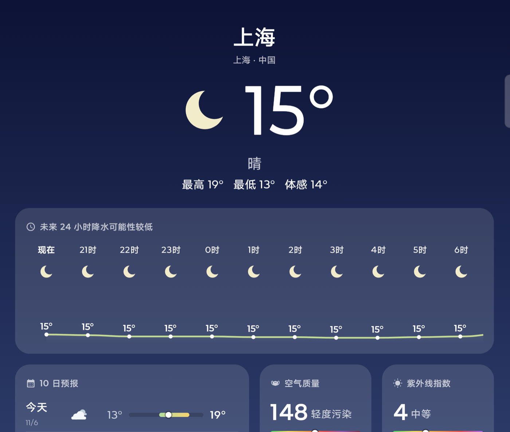
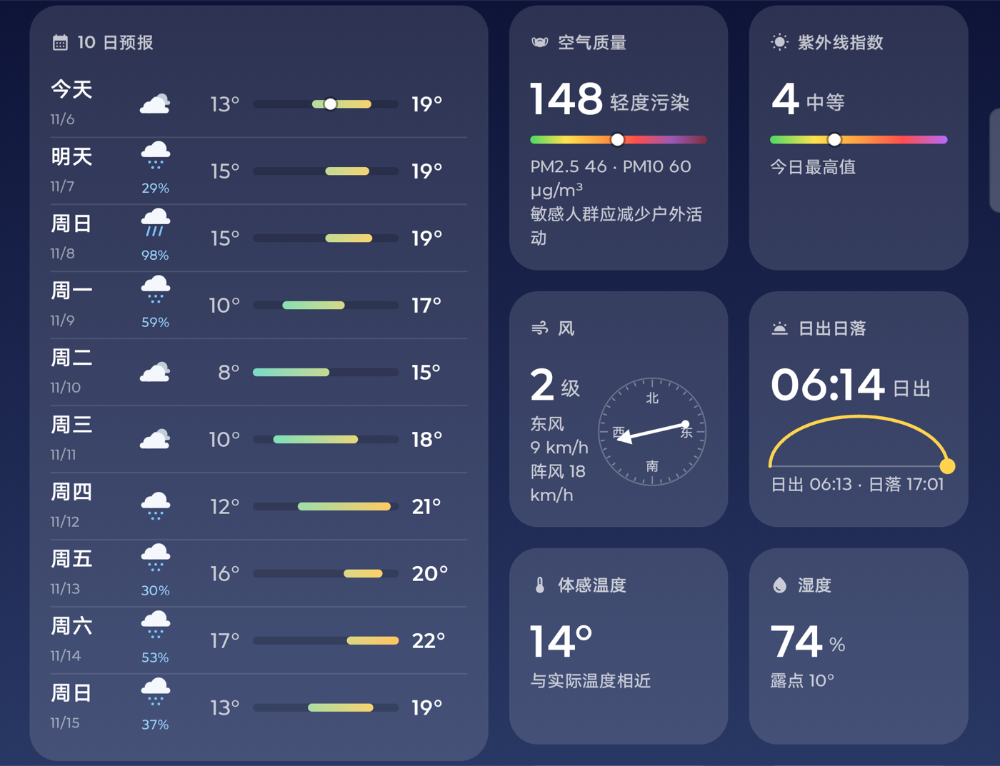
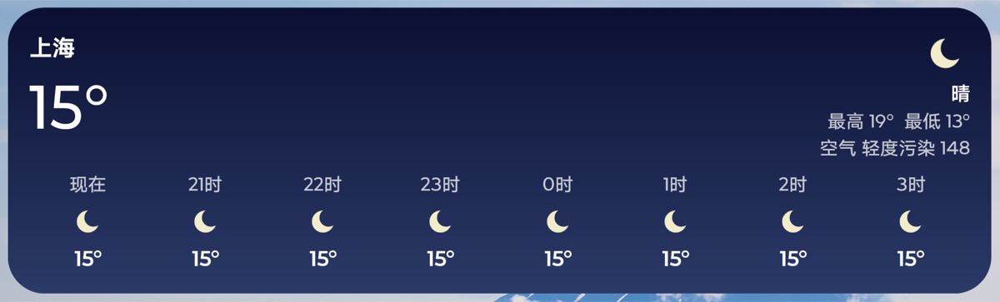

# WeatherPad

Android 平板天气应用（Kotlin + Jetpack Compose），全部使用免费、开源、无需 API Key 的数据源。

## 数据源

| 用途 | 服务 | 许可 |
|---|---|---|
| 实时 / 逐小时 / 10 日预报 | [Open-Meteo Forecast API](https://open-meteo.com/) | 代码 AGPL-3.0，数据 CC BY 4.0 |
| 空气质量（US AQI、PM2.5、PM10） | Open-Meteo Air Quality API | 同上 |
| 城市搜索 | Open-Meteo Geocoding API（GeoNames） | 同上 |
| 当前位置的城市名 | OpenStreetMap Nominatim 反向地理编码 | ODbL |

定位只用系统 `LocationManager`，不依赖 Google Play 服务。

## 功能

- 横屏双栏（城市列表 + 详情），竖屏抽屉；背景按天气和昼夜渐变
- 当前天气、未来 24 小时温度曲线与降水概率、10 日预报温度区间条
- 空气质量、紫外线、风（级数 + 指南针）、日出日落弧线、体感、湿度/露点、降水、能见度、气压、云量
- 城市搜索（中文 / 拼音 / 英文）、长按删除、下拉刷新、15 分钟过期自动刷新
- 离线缓存：每个城市最近一次数据保存在本地

## 截图

主界面：



10 日预报和详情卡片：



桌面小组件（中号）：



## 桌面小组件

长按桌面 → 添加小部件 → 天气。小组件跟随 App 当前选中的城市，每 30 分钟后台刷新一次。

| 形态 | 默认尺寸 | 内容 |
|---|---|---|
| 小号 | 2×2 | 城市、温度、天气、最高最低 |
| 条形 | 4×1 | 一行显示温度、天气，够宽时加 AQI |
| 中号 | 4×2 | 当前天气 + 逐小时 |
| 大号 | 4×4 | 当前天气 + 逐小时 + 多日预报 |
| 城市列表 | 4×3 | 所有城市，点击打开对应城市 |

## 构建与安装

```bash
./gradlew :app:assembleDebug
adb install -r app/build/outputs/apk/debug/app-debug.apk
```
